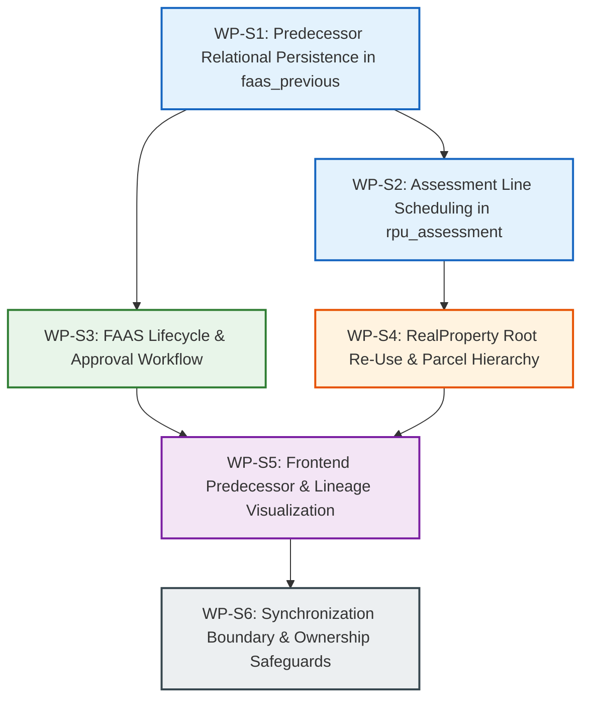
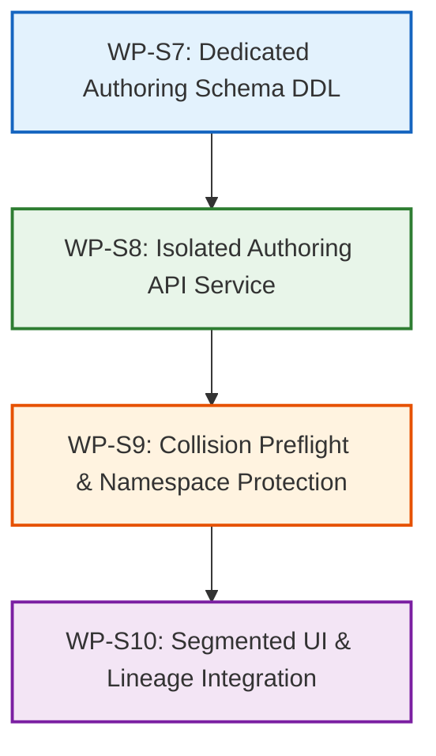

# ETRACS Shadow Subsystem: Implementation Roadmap (Isolated Authoring Architecture)

**Document Date:** October 21, 2026 (Updated — Phase 5C Isolated Authoring Architecture)  
**Phase:** Phase 5 — Requirements Mapping & Implementation Planning  
**Target System:** Dedicated ETRACS Shadow Subsystem (`assessor-backend` & `assessor-frontend`)  
**Core Boundary Rule:** **ALL NATIVE ASSESSOR TABLES ARE OUT OF SCOPE.** Native tables (`wp_assessor_properties`, property states, versions, documents, audit logs, requests, cloud sync) and their existing relationships remain 100% untouched. No sidecar cross-reference tables or migrations linking ETRACS to native records will be created.

---

## 1. Roadmap Strategy and Guiding Principles

1. **Strict Subsystem Isolation:** All ETRACS-specific functionality is implemented exclusively within the existing ETRACS shadow module.
2. **Preserve Replica Integrity:** The 35+ existing source-replicated shadow tables (`wp_assessor_faas`, `wp_assessor_rpu`, `wp_assessor_real_property`, `wp_assessor_faas_previous`, `wp_assessor_rpu_assessment`, etc.) remain **strictly read-only** to local authoring operations.
3. **Dedicated Authoring Staging Namespace:** To guarantee absolute immunity against external sync pulls (`Assessor_Etracs_Sync::trigger_sync()`), locally authored transactions reside in a minimal, dedicated shadow authoring set (`wp_assessor_etracs_authored_*`).
4. **Preserve Native Architecture:** The primary native application (`wp_assessor_properties`), its public search API, document issuance, and bidirectional cloud sync remain completely decoupled and undisturbed.
5. **Clear Synchronization Boundary:** Pull sync operations continue to populate the replica tables via `$wpdb->replace()` without touching, replacing, or colliding with authored transactions.
6. **No Immediate Code Changes in Phase 5:** This roadmap establishes work packages, prerequisites, risks, and acceptance criteria for subsequent implementation phases.

---

## 2. Work Package Breakdown (Isolated Shadow Authoring)



---

### Work Package S1: Predecessor Relational Persistence (`wp_assessor_faas_previous`)
- **Objective:** Enable `create_faas()` and `update_faas()` in `class-assessor-etracs.php` to write multi-predecessor records and locked snapshot values directly into the existing `wp_assessor_faas_previous` table.
- **Affected Files:**
  - `assessor-backend/wp-content/plugins/assessor-api/includes/class-assessor-etracs.php`
- **Existing Schema Utilized (No DDL Required):**
  - Table `wp_assessor_faas_previous`: `objid`, `faasid`, `prevfaasid`, `prevrpuid`, `prevtdno`, `prevpin`, `prevowner`, `prevav`, `prevmv`, `prevareasqm`, `prevareaha`, `preveffectivity`.
- **Implementation Steps:**
  1. In `create_faas()`, if `predecessors` array or `prevtdno` is provided, insert row(s) into `wp_assessor_faas_previous`.
  2. Populate `prevfaasid` if the predecessor TD resolves to an existing shadow FAAS record; set `prevfaasid = NULL` if it is a recorded historical tax roll reference. Preserve legacy unresolved pointers without throwing errors.
  3. Store locked snapshot values (`prevowner`, `prevpin`, `prevav`, `prevmv`, `prevareasqm`, `preveffectivity`) at the time of creation.
  4. In `get_faas()`, return structured `predecessors` array alongside legacy string properties, including `resolution_status` (`ELECTRONIC`, `RECORDED_ONLY`, `LEGACY_UNRESOLVED`).
- **Acceptance Criteria:**
  - Creating a FAAS with multiple predecessors successfully creates corresponding rows in `wp_assessor_faas_previous`.
  - Snapshot values are locked and verified against `wp_assessor_faas_previous`.

---

### Work Package S2: Assessment Line Scheduling (`wp_assessor_rpu_assessment`)
- **Objective:** Enable `create_faas()` and `update_faas()` to persist granular assessment lines into the existing `wp_assessor_rpu_assessment` table.
- **Affected Files:**
  - `assessor-backend/wp-content/plugins/assessor-api/includes/class-assessor-etracs.php`
- **Existing Schema Utilized (No DDL Required):**
  - Table `wp_assessor_rpu_assessment`: `objid`, `rpuid`, `classification_objid`, `actualuse_objid`, `marketvalue`, `assesslevel`, `assessedvalue`, `taxable`, `areasqm`, `areaha`, `classcode`, `classname`, `actualuse`.
- **Implementation Steps:**
  1. In `create_faas()` and `update_faas()`, accept an `assessments` array.
  2. For each assessment line, insert/upsert into `wp_assessor_rpu_assessment` keyed by `rpuid`.
  3. Compute `total_market_value` and `total_assessed_value` on `wp_assessor_rpu` as the deterministic sum of child assessment lines.
- **Acceptance Criteria:**
  - New FAAS declarations can store multiple actual-use lines (e.g. residential + commercial).
  - Assessment lines render in `TaxDeclarationPreviewModal.js` and match `total_assessed_value`.

---

### Work Package S3: FAAS Lifecycle & Approval Workflow
- **Objective:** Support formal lifecycle states (`INTERIM`, `FORAPPROVAL`, `CURRENT`, `CANCELLED`) and assessor approval workflows within the shadow subsystem.
- **Affected Files:**
  - `assessor-backend/wp-content/plugins/assessor-api/includes/class-assessor-etracs.php`
  - `assessor-backend/wp-content/plugins/assessor-api/includes/class-assessor-api.php`
- **Existing Schema Utilized (No DDL Required):**
  - `wp_assessor_faas.state` (`INTERIM`, `FORAPPROVAL`, `CURRENT`, `CANCELLED`), `wp_assessor_faas.dtapproved`.
- **Implementation Steps:**
  1. Update `create_faas()` to allow specifying initial state (`INTERIM` or `CURRENT`).
  2. Register endpoint `POST /assessor/v1/etracs/faas/(?P<id>[a-zA-Z0-9\-\:]+)/approve`:
     - Sets `state = 'CURRENT'` and `dtapproved = NOW()`.
     - Automatically cancels resolved predecessor FAAS declarations (`state = 'CANCELLED'`, `cancelreason = 'SUPERSEDED'`, `cancelledbytdnos = [current TD]`).
  3. Ensure `cancel_faas()` enforces validation that `cancelreason` and `cancelledbytdnos` are recorded.
- **Acceptance Criteria:**
  - An interim appraisal draft can be saved, submitted for approval, and approved into an active current declaration.

---

### Work Package S4: RealProperty Root Re-Use & Parcel Hierarchy
- **Objective:** Prevent redundant duplicate parcel creation when creating subsequent revisions or additional improvement RPUs for an existing parcel.
- **Affected Files:**
  - `assessor-backend/wp-content/plugins/assessor-api/includes/class-assessor-etracs.php`
- **Existing Schema Utilized (No DDL Required):**
  - `wp_assessor_real_property`, `wp_assessor_rpu.realpropertyid`, `wp_assessor_rpumaster`.
- **Implementation Steps:**
  1. In `create_faas()`, accept an optional `realpropertyid`.
  2. If provided and valid, attach the new RPU to the existing `realproperty` record instead of creating a duplicate row.
  3. If not provided, call `create_real_property()` as currently implemented.
- **Acceptance Criteria:**
  - Multiple FAAS records (e.g. Land + Building) can share a single `realpropertyid`.

---

### Work Package S5: Frontend Predecessor & Lineage Visualization in Shadow UI
- **Objective:** Upgrade `EtracsPropertyFormModal.js`, `EtracsPropertyTable.js`, and `TaxDeclarationPreviewModal.js` to support multi-predecessors, assessment line editing, and cancellation metadata entry.
- **Affected Files:**
  - `assessor-frontend/src/components/EtracsPropertyFormModal/EtracsPropertyFormModal.js`
  - `assessor-frontend/src/components/EtracsPropertyTable/EtracsPropertyTable.js`
  - `assessor-frontend/src/components/EtracsPropertyTable/TaxDeclarationPreviewModal.js`
- **Implementation Steps:**
  1. In `EtracsPropertyFormModal.js`, add an assessment schedule editor tab allowing users to add/remove actual use lines with automatic calculation of Assessed Value (`MV * AL%`).
  2. In `EtracsPropertyFormModal.js`, support adding multiple predecessor TDs.
  3. In `EtracsPropertyTable.js`, update the Cancel dialog to include a `Cancelled by TD No.` input field.
  4. In `TaxDeclarationPreviewModal.js`, display predecessor lineage history and structured snapshot details.
- **Acceptance Criteria:**
  - Form allows inputting multiple assessment lines and multiple predecessors.
  - Cancel dialog captures `cancelledbytdnos`.

---

### Work Package S6: Synchronization Boundary & Ownership Safeguards
- **Objective:** Establish clear ownership and operational boundaries between external ETRACS replication and local shadow authoring.
- **Affected Files:**
  - `assessor-backend/wp-content/plugins/assessor-api/includes/class-assessor-etracs-sync.php`
  - `assessor-backend/wp-content/plugins/assessor-api/includes/class-assessor-settings.php`
  - `assessor-frontend/src/components/Settings/Settings.js`
- **Implementation Steps:**
  1. In `class-assessor-settings.php`, document or expose a toggle for `etracs_shadow_write_mode`:
     - `READ_ONLY_MIRROR`: Default. Pull sync updates local shadow tables from `etracs254_kitaotao`. UI creates warning before executing edits.
     - `INDEPENDENT_LOCAL`: Pull sync is disabled; shadow tables are authored and managed locally without external overwrite risk.
  2. If `READ_ONLY_MIRROR` is active, warn administrator before performing write operations that an external sync pull will overwrite local changes.
- **Acceptance Criteria:**
  - Administrators are protected against unexpected sync overwrite of authored shadow data.

---

## 3. Explicitly Out-of-Scope Items

| Item | Classification | Rationale |
| :--- | :--- | :--- |
| **Any modification to `wp_assessor_properties`** | **STRICTLY PROHIBITED** | Native core application table; completely out of scope. |
| **Native-to-ETRACS sidecar mapping (`wp_assessor_etracs_crossref`)** | **REMOVED** | Cross-model sidecars violate the architecture boundary. |
| **Native Predecessor Join Table (`wp_assessor_property_predecessors`)** | **REMOVED** | Targets native properties; out of scope. |
| **Native Assessment Line Table (`wp_assessor_property_assessments`)** | **REMOVED** | Targets native properties; out of scope. |
| **Cloud Synchronization of Shadow Tables (`class-assessor-sync.php`)** | **OUT OF SCOPE** | Shadow tables remain strictly local to the administrative workstation/intranet. |
| **ETRACS Treasury Ledgers (`rptledger`)** | **OUT OF SCOPE** | Municipal Treasury office responsibility; not part of Assessor scope. |
| **Automatic In-Place PIN Normalization** | **REJECTED** | Phase 5A.1 proved normalization creates collisions; original strings must be preserved. |

---

## 4. Phase 5C Design: Isolated Local Authoring Architecture

### Detailed Technical Specifications for Work Packages S7 to S10



#### Work Package S7: Dedicated Authoring Schema DDL
- **Objective:** Deploy the minimal, dedicated table structure for local ETRACS declaration authoring, physically isolated from the read-only replica tables.
- **Target Tables Created:**
  1. `wp_assessor_etracs_authored_faas`: Header records (`authoring_id` UUIDv7 PK, `state`, `tdno`, `utdno`, `txntype_code`, `real_property_ref_id`, `taxpayer_entity_id`, `effectivity_year`, `effectivity_qtr`, `memoranda`, `dtapproved`, `approved_by`, `cancel_reason`, `cancel_date`, `cancelled_by_tdnos`).
  2. `wp_assessor_etracs_authored_predecessors`: Lineage & snapshot tracking (`id` UUIDv7 PK, `authored_faas_id` FK, `source_faas_objid` nullable, `source_authored_id` nullable, `recorded_tdno`, `resolution_status`, `prev_owner`, `prev_pin`, `prev_av`, `prev_mv`, `prev_area_sqm`, `prev_effectivity`).
  3. `wp_assessor_etracs_authored_assessments`: Assessment breakdown lines (`id` UUIDv7 PK, `authored_faas_id` FK, `classification_code`, `actual_use_name`, `market_value`, `assessment_level`, `assessed_value`, `area_sqm`, `taxable`, `sort_order`).
- **Sync Immunity Assurance:**
  - These tables are **never** listed in `$tables_to_sync_direct` in `class-assessor-etracs-sync.php`.
  - Executing `trigger_sync()` has zero awareness of and zero access to these tables, providing 100% architectural immunity against sync overwrites or deletions.

#### Work Package S8: Isolated Authoring API Service
- **Objective:** Implement dedicated backend service methods and REST controllers operating strictly on authored tables.
- **Target Endpoints:**
  - `GET /assessor/v1/etracs/authoring/declarations`: Paginated list of authored declarations with state and search filters.
  - `POST /assessor/v1/etracs/authoring/declarations`: Creates a new authored declaration in `DRAFT` state.
  - `GET /assessor/v1/etracs/authoring/declarations/{id}`: Retrieves authored declaration with child predecessors and assessments.
  - `PUT /assessor/v1/etracs/authoring/declarations/{id}`: Updates declaration (permitted only when `state IN ('DRAFT', 'SUBMITTED')`).
  - `POST /assessor/v1/etracs/authoring/declarations/{id}/submit`: Transitions `DRAFT` $\rightarrow$ `SUBMITTED`.
  - `POST /assessor/v1/etracs/authoring/declarations/{id}/approve`: Transitions `SUBMITTED` $\rightarrow$ `APPROVED`, records `approved_by = current_user_id` and `dtapproved = NOW()`.
  - `POST /assessor/v1/etracs/authoring/declarations/{id}/cancel`: Sets `state = 'CANCELLED'`, recording mandatory `cancel_reason` and `cancelled_by_tdnos`.

#### Work Package S9: Collision Preflight & Namespace Protection
- **Objective:** Prevent duplicate TD number collisions across replica and authored namespaces without altering source replica tables.
- **Preflight Mechanics:**
  - Before inserting or updating an authored TD number, execute:
    ```sql
    SELECT 'REPLICA' as origin, tdno, state FROM wp_assessor_faas WHERE tdno = %s AND state != 'CANCELLED'
    UNION ALL
    SELECT 'AUTHORED' as origin, tdno, state FROM wp_assessor_etracs_authored_faas WHERE tdno = %s AND authoring_id != %s AND state != 'CANCELLED'
    ```
  - If a match is found and transaction type is not `CE` (Correction of Entry), halt execution and return:
    ```json
    {
      "code": "TD_NUMBER_COLLISION",
      "message": "Tax Declaration Number already exists in ETRACS records.",
      "data": { "origin": "REPLICA", "existing_state": "CURRENT" }
    }
    ```
  - If a source pull imports a record that shares a TD number with an authored draft, both records remain preserved. The authoring UI displays a warning banner: `[WARNING: Upstream ETRACS record imported with matching TDN. Review before approval.]`

#### Work Package S10: Segmented UI & Lineage Integration
- **Objective:** Update frontend components in `assessor-frontend` to clearly separate read-only archive records from authored declarations.
- **UI Architecture:**
  - In `EtracsPropertyTable.js`, add top-level segmented navigation:
    - **Tab 1: "ETRACS Historical Archive (Read-Only)"** — Queries `GET /etracs/faas`. Displays lock badge. Edits disabled. View official FAAS active.
    - **Tab 2: "Local Authoring Queue"** — Queries `GET /etracs/authoring/declarations`. Displays lifecycle badges (`DRAFT`, `SUBMITTED`, `APPROVED`, `CANCELLED`). Full editing enabled based on role.
  - In `TaxDeclarationPreviewModal.js`, support previewing both source-replicated FAAS records and locally authored records seamlessly.

---

## 5. Implementation Phasing & Next Steps

1. **Phase 6: Authoring Schema & API Foundations (WP-S7 & WP-S8)**
   - Create isolated authoring tables.
   - Implement `/etracs/authoring/*` endpoints.
2. **Phase 7: Conflict Preflight & Workflow Validation (WP-S9 & WP-S3)**
   - Deploy collision preflight checks.
   - Enforce lifecycle transition rules and approval sign-offs.
3. **Phase 8: Frontend Tabs & Lineage Integration (WP-S10 & WP-S5)**
   - Deploy segmented tabs in `EtracsPropertyTable.js`.
   - Update `TaxDeclarationPreviewModal.js` to render multi-predecessors and assessment schedules.
