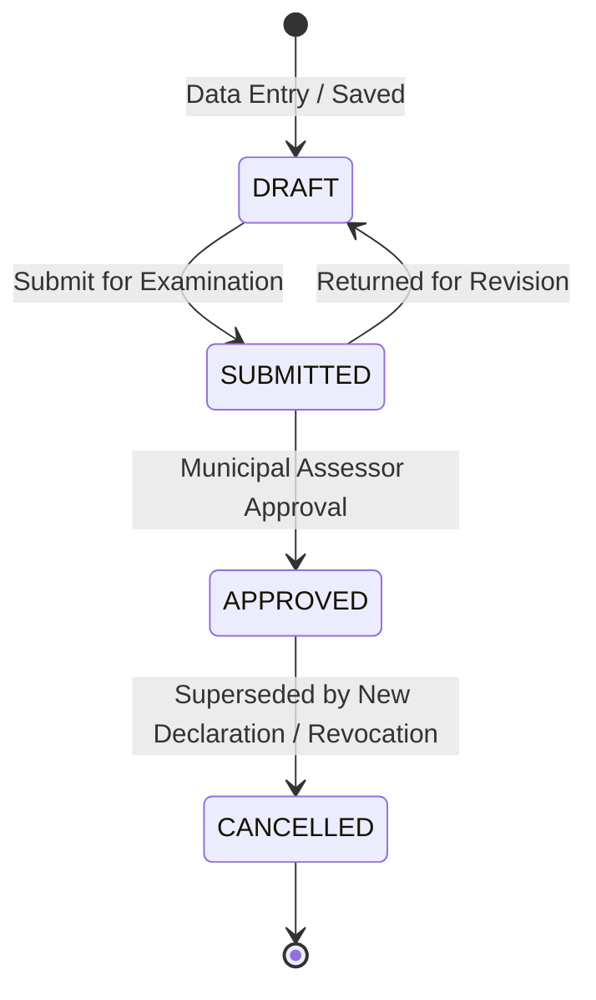

# ETRACS 2.54 / 2.55 → Assessor Repo: Requirements Mapping & Capability Matrix (Shadow Subsystem Focus)

**Document Date:** October 21, 2026 (Updated — Phase 5C Isolated Authoring Architecture)  
**Investigation Context:** Phase 5 Requirements Mapping & Gap Analysis  
**Architecture Scope:** **Strictly ETRACS Shadow Subsystem Only**  
**Core Boundary Rule:** **ALL NATIVE ASSESSOR TABLES ARE OUT OF SCOPE.** Native tables (`wp_assessor_properties`, property states, versions, documents, audit logs, requests, cloud sync) and their existing relationships remain 100% untouched.

---

## Executive Summary & Architecture Overview

The Assessor repository contains two distinct, coexisting subsystems within the WordPress backend plugin (`assessor-api`) and React frontend (`assessor-frontend`):

1. **Native Assessor Property Subsystem (`wp_assessor_properties`, etc.):**
   - Flat, denormalized municipal records managed by the primary web application and synchronized to the live website via bidirectional HMAC cloud synchronization (`class-assessor-sync.php`).
   - **STRICTLY OUT OF SCOPE:** No migrations, sidecar link tables, column modifications, schema changes, or record relinking target this subsystem.

2. **Dedicated ETRACS Shadow Subsystem (`wp_assessor_faas`, `wp_assessor_rpu`, `wp_assessor_real_property`, etc.):**
   - A fully formed, normalized relational schema directly mirroring the ETRACS 2.54/2.55 database tables.
   - Populated historically via `Assessor_Etracs_Sync::trigger_sync()` from local MySQL database `etracs254_kitaotao`.
   - Exposed through dedicated, isolated REST endpoints under `/assessor/v1/etracs/*` (`class-assessor-etracs.php`).
   - Rendered in dedicated administrative frontend components (`EtracsPropertyTable`, `EtracsPropertyFormModal`, `EtracsEntityTable`, `TaxDeclarationPreviewModal`, `BuildingFaasEditor`).

**Objective:** Map validated ETRACS 2.54/2.55 lifecycle and lineage capabilities **exclusively into the existing ETRACS shadow subsystem**. All requirements are evaluated against the existing shadow tables and endpoints without adding cross-subsystem dependencies.

---

## Section A: FAAS and Tax Declaration Lifecycle

### 1. ETRACS Behavior & Evidence
- **Declaration Identity:** In ETRACS, a declaration is a `faas` record keyed by `objid` (varchar 50).
- **States:** ETRACS defines lifecycle states: `INTERIM` (Draft), `FORAPPROVAL` (Submitted), `CURRENT` (Active/Approved), and `CANCELLED`.
- **Cancellation:** When a declaration becomes `CURRENT`, its predecessor declaration is transitioned to `CANCELLED`, recording `cancelreason`, `canceldate`, `cancelledtimestamp`, and `cancelledbytdnos`.

### 2. Existing Shadow Subsystem Implementation
- **Files Inspected:**
  - Backend: `class-assessor-etracs.php` (`get_faas_list`, `get_faas`, `create_faas`, `update_faas`, `cancel_faas`, `delete_faas`)
  - Schema: `wp_assessor_faas` (contains `objid`, `state`, `rpuid`, `realpropertyid`, `taxpayer_objid`, `tdno`, `utdno`, `txntype_objid`, `effectivityyear`, `owner_name`, `cancelreason`, `canceldate`, `cancelledbytdnos`, `dtapproved`, `txntimestamp`)
  - Frontend: `EtracsPropertyTable.js`, `EtracsPropertyFormModal.js`, `TaxDeclarationPreviewModal.js`
- **Current Behavior in Shadow Module:**
  - `create_faas()`: Inserts into `wp_assessor_faas` with hardcoded `state = 'CURRENT'`. Cancels the predecessor TD if `prevtdno` is provided (lines 512–521).
  - `update_faas()`: Updates mapped fields in `wp_assessor_faas`, `wp_assessor_rpu`, and `wp_assessor_real_property`.
  - `cancel_faas()`: Sets `state = 'CANCELLED'`, `cancelreason`, `canceldate`, `cancelnote`, and `cancelledbytdnos` (lines 666–689).
  - Frontend: `EtracsPropertyTable.js` displays status chips (`CURRENT`, `CANCELLED`, `DELETED`), provides search, filtering by state, RPU type, and transaction type.
- **Identified Gaps in Shadow Module:**
  1. *Lack of Draft/Approval Gates in API:* `create_faas()` hardcodes `state = 'CURRENT'`. There is no endpoint to save an `INTERIM` draft or transition to `FORAPPROVAL` before final approval.
  2. *Cancel Dialog Missing TD Field:* The frontend `cancel_faas` modal prompts for reason and note, but does not capture `cancelledbytdnos`.

### 3. Target Requirements for Shadow Subsystem
- Allow `create_faas()` to accept `state` (`INTERIM`, `FORAPPROVAL`, `CURRENT`).
- Add an explicit `approve_faas` endpoint that transitions `FORAPPROVAL` to `CURRENT`, populates `dtapproved`, and executes predecessor cancellation.
- Update `EtracsPropertyTable.js` cancellation modal to prompt for the successor TD number (`cancelledbytdnos`).

---

## Section B: Historical Predecessor Relationships

### 1. ETRACS Behavior & Evidence
- ETRACS maintains predecessor relationships in `faas_previous` (18,853 rows in shadow replica) alongside locked snapshot fields (`prevowner`, `prevpin`, `prevav`, `prevmv`, `prevareasqm`, `preveffectivity`).
- Provenance Typologies:
  - Case 1: `prevfaasid` resolves to existing FAAS (`ELECTRONIC`).
  - Case 2: `prevfaasid IS NULL` but `prevtdno` is recorded (“Recorded historical TD reference; source provenance unknown unless supported by separate documentary evidence”).
  - Case 3: `prevfaasid` populated but does not resolve (`LEGACY_UNRESOLVED`).

### 2. Existing Shadow Subsystem Implementation
- **Files Inspected:**
  - Backend: `class-assessor-etracs.php` (lines 204–218, 369–382: `get_faas_list`, `get_faas`)
  - Schema: `wp_assessor_faas_previous` (contains `objid`, `faasid`, `prevfaasid`, `prevrpuid`, `prevtdno`, `prevpin`, `prevowner`, `prevav`, `prevmv`, `prevareasqm`, `preveffectivity`)
  - Frontend: `EtracsPropertyFormModal.js` (lines 188–206), `TaxDeclarationPreviewModal.js`
- **Current Behavior in Shadow Module:**
  - `get_faas()` queries `wp_assessor_faas_previous` using `GROUP_CONCAT` and performs dynamic fallback lookup against `wp_assessor_faas` if snapshot fields are blank.
  - In `EtracsPropertyFormModal.js`, selecting a predecessor TD from autocomplete auto-populates `prev_owner`, `prev_pin`, and `prev_assessed_value`.
  - **Critical Gap:** When `create_faas()` or `update_faas()` runs, it only writes scalar predecessor strings to `wp_assessor_faas` (`prevtdno`, `prevowner`, `prevav`). **It does not insert child rows into `wp_assessor_faas_previous`**.
- **Identified Gaps in Shadow Module:**
  1. *No Insertion into `wp_assessor_faas_previous` on Create:* Newly authored declarations in the shadow module leave `wp_assessor_faas_previous` empty.
  2. *Resolution Status Not Returned:* The API does not classify whether the predecessor is `ELECTRONIC`, `RECORDED_ONLY`, or `LEGACY_UNRESOLVED`.

### 3. Target Requirements for Shadow Subsystem
- Extend `create_faas()` and `update_faas()` to insert/upsert records into the existing `wp_assessor_faas_previous` table when predecessors are specified.
- Update `get_faas()` to return structured predecessor objects including `resolution_status`.
- Support multiple predecessors (N:1 consolidation) in `EtracsPropertyFormModal.js`.

---

## Section C: Property, RPU, and Parcel Hierarchy

### 1. ETRACS Behavior & Evidence
- Three-tier entity model:
  1. `realproperty`: Physical geographic parcel (`pin`, `cadastrallotno`, `surveyno`, `blockno`, `barangay`).
  2. `rpu`: Assessment revision unit tied to a FAAS (`rpu_type`, `classification`, `totalmv`, `totalav`).
  3. `rpumaster`: Master root tracking parcel/unit continuity across general revisions.

### 2. Existing Shadow Subsystem Implementation
- **Files Inspected:**
  - Backend: `class-assessor-etracs.php` (`create_real_property`, `create_rpu`, `update_real_property`, `update_rpu`, `get_rpu_detail`)
  - Schema: `wp_assessor_real_property`, `wp_assessor_rpu`, `wp_assessor_rpumaster`
  - Frontend: `EtracsPropertyFormModal.js`, `BuildingFaasEditor.js`
- **Current Behavior in Shadow Module:**
  - `create_faas()` automatically invokes `create_real_property()` and `create_rpu()` and links their `objid`s into the new `wp_assessor_faas` record.
  - Subtype details are fully implemented: `wp_assessor_landdetail`, `wp_assessor_bldgrpu`, `wp_assessor_bldgstructure`, `wp_assessor_bldgfloor`, `wp_assessor_bldgflooradditional`, `wp_assessor_machrpu`, `wp_assessor_planttreerpu`.
- **Identified Gaps in Shadow Module:**
  1. *Subsequent Revisions Create Duplicate Real Property Roots:* When creating a new revision for an existing parcel, `create_faas()` always creates a brand new `realproperty` row rather than permitting linkage to an existing `realpropertyid`.
  2. *`rpumaster` Not Updated on Writes:* `wp_assessor_rpumaster` is populated during read-only sync, but is not updated when new transactions are issued via `class-assessor-etracs.php`.

### 3. Target Requirements for Shadow Subsystem
- Allow `create_faas()` to accept an optional existing `realpropertyid`, linking multiple RPU revisions or improvements to the same physical land parcel.
- Optionally update `wp_assessor_rpumaster` pointers (`currentfaasid`, `currentrpuid`) when transactions are approved.

---

## Section D: Assessment and Valuation

### 1. ETRACS Behavior & Evidence
- Detailed statutory valuation schedule in `rpu_assessment`: `marketvalue`, `assesslevel`, `assessedvalue`, `actualuse_objid`, `classcode`.
- Supported across Land, Building, Machinery, and Plant/Tree assessment schedules.

### 2. Existing Shadow Subsystem Implementation
- **Files Inspected:**
  - Backend: `class-assessor-etracs.php` (lines 959–977: `get_rpu_detail`)
  - Backend Sync: `class-assessor-etracs-sync.php` (lines 307–340)
  - Schema: `wp_assessor_rpu_assessment` (22,430 rows in shadow replica)
  - Frontend: `EtracsPropertyFormModal.js` (lines 61, 116), `TaxDeclarationPreviewModal.js` (lines 91, 140–180)
- **Current Behavior in Shadow Module:**
  - `get_rpu_detail()` queries `wp_assessor_rpu_assessment` and returns all assessment lines for an RPU.
  - `TaxDeclarationPreviewModal.js` renders the statutory assessment schedule (Market Value, Assessment Level, Assessed Value) per actual use.
  - **Critical Gap:** `create_faas()` and `update_faas()` only record aggregate scalars (`total_market_value`, `total_assessed_value`) on `wp_assessor_rpu`. **They do not write child lines into `wp_assessor_rpu_assessment`**.

### 3. Target Requirements for Shadow Subsystem
- Extend `create_faas()` and `update_faas()` to accept an array of assessment lines and persist them into `wp_assessor_rpu_assessment`.
- Ensure `total_market_value` and `total_assessed_value` on `wp_assessor_rpu` are computed as the sum of child lines.

---

## Section E: Synchronization, Write Permissions & Table Ownership

### 1. Current Architecture
- The ETRACS shadow subsystem is populated via `Assessor_Etracs_Sync::trigger_sync()` (`class-assessor-etracs-sync.php`) through direct PDO queries from `etracs254_kitaotao`.
- The synchronization uses `$wpdb->replace()` across shadow tables (`wp_assessor_faas`, `wp_assessor_rpu`, `wp_assessor_real_property`, `wp_assessor_entity`, etc.).
- **Ownership Conflict:** Because `trigger_sync()` executes a full replacement, any manual creation or edit performed via `class-assessor-etracs.php` would be overwritten if an external sync pull is executed from `etracs254_kitaotao`.

### 2. Resolution & Operating Rules
- **Rule 1:** Explicitly define the operating mode of the shadow subsystem in `class-assessor-settings.php`:
  - *Mode A (Read-Only Mirror):* Shadow tables are refreshed from external ETRACS; UI allows inspection, search, printing, and verification only.
  - *Mode B (Independent Local ETRACS Instance):* External sync is disabled/decoupled; shadow tables serve as the local operational ETRACS repository with full write permissions.
- **Rule 2:** Do not modify `class-assessor-sync.php` (the native cloud sync engine). The shadow subsystem is strictly local/manager-level and is not broadcast to the live public WordPress site.

---

## Section F: Phase 5C Isolated Authoring Architecture

### 1. The Smallest Maintainable Authoring Schema
To ensure source-replicated shadow tables (`wp_assessor_faas`, `wp_assessor_rpu`, `wp_assessor_real_property`, `wp_assessor_faas_previous`, `wp_assessor_rpu_assessment`) remain **strictly read-only** and 100% immune to external sync pulls, local transaction authoring is isolated into a minimal, dedicated shadow authoring set:

1. **`wp_assessor_etracs_authored_faas` (Header & Lifecycle):**
   - Stores locally authored FAAS transactions through draft, verification, approval, and cancellation.
   - Primary Key: `authoring_id` (varchar 36, UUIDv7).
   - Core Fields: `state` (`DRAFT`, `SUBMITTED`, `APPROVED`, `CANCELLED`), `tdno`, `utdno`, `txntype_code` (`TR`, `CS`, `SD`, `RE`, `GR`), `effectivity_year`, `effectivity_qtr`, `title_type`, `title_no`, `title_date`, `memoranda`.
   - Links: `real_property_ref_id` (varchar 50, points to existing `wp_assessor_real_property.objid` or a local authored parcel), `taxpayer_entity_id` (varchar 50, points to `wp_assessor_entity.objid`).
   - Audit & Sign-off: `created_by`, `created_at`, `submitted_by`, `submitted_at`, `approved_by`, `approved_at`, `dtapproved`.
   - Cancellation Tracking: `cancel_reason`, `cancel_date`, `cancelled_by_tdnos`, `cancelled_timestamp`.
2. **`wp_assessor_etracs_authored_predecessors` (Lineage & Locked Snapshots):**
   - Supports 1:1 transfers, 1:N subdivisions, and N:1 consolidations.
   - Primary Key: `id` (varchar 36, UUIDv7).
   - Foreign Key: `authored_faas_id` (points to `wp_assessor_etracs_authored_faas.authoring_id`).
   - Reference Pointers: `source_faas_objid` (nullable, points to historical `wp_assessor_faas.objid` if predecessor was electronic), `source_authored_id` (nullable, points to predecessor if it was also locally authored), `recorded_tdno` (non-null text citation).
   - Provenance Classification: `resolution_status` (`REPLICA_RESOLVED`, `AUTHORED_RESOLVED`, `RECORDED_HISTORICAL`, `LEGACY_UNRESOLVED`).
   - Locked Snapshot Fields: `prev_owner`, `prev_pin`, `prev_av`, `prev_mv`, `prev_area_sqm`, `prev_effectivity`.
3. **`wp_assessor_etracs_authored_assessments` (Statutory Breakdown Lines):**
   - Primary Key: `id` (varchar 36, UUIDv7).
   - Foreign Key: `authored_faas_id`.
   - Fields: `classification_code`, `actual_use_name`, `market_value`, `assessment_level`, `assessed_value`, `area_sqm`, `taxable`, `sort_order`.
   - Totals Rule: `total_market_value` and `total_assessed_value` on the authored header are deterministically derived from the sum of child lines.

### 2. Declaration Lifecycle & State Machine

- **Editing Constraints:**
  - `DRAFT`: Fully editable by `editor`, `assessor`, `admin`, `superadmin`.
  - `SUBMITTED`: Read-only to `editor`; editable/returnable by `assessor`, `admin`.
  - `APPROVED`: **Strictly immutable.** Cannot be edited in-place. If an error is detected, a `CE` (Correction of Entry) or new revision transaction must be issued.
  - `CANCELLED`: Immutable historical record.
- **Predecessor Handling on Approval:**
  - When an authored FAAS reaches `APPROVED`, the predecessor is referenced without modifying the source replica table:
    - If the predecessor is in `wp_assessor_etracs_authored_faas`, its state is transitioned to `CANCELLED`.
    - If the predecessor is in read-only `wp_assessor_faas`, the source replica is **not modified**. Instead, the supersession link is recorded in `wp_assessor_etracs_authored_predecessors`, and the UI displays the source declaration as "Superseded in Local Authoring (by TD [X])" based on a dynamic join.

### 3. Identifier & TD Conflict Resolution Strategy
- **Conflict Rule:** An authored declaration must never overwrite or collide with a source replica declaration.
- **Detection Mechanism:**
  - On saving `DRAFT` or `SUBMITTED`, the backend checks for duplicate TD numbers across:
    1. Read-only `wp_assessor_faas.tdno` (source replica).
    2. Active `wp_assessor_etracs_authored_faas.tdno` (local authored).
  - If a collision occurs with an active CURRENT record:
    - If transaction type is `CE` (Correction of Entry), system flags: `TRANSACTION_TYPE_REVISION` and links to the predecessor.
    - If transaction type is `ND`/`TR`/`CS`/`SD`, save is halted with error: `TD_NUMBER_COLLISION: Tax Declaration [X] already exists in historical ETRACS records.`
- **Protection of Local Records on Future Sync Pulls:**
  - Because authored records reside in `wp_assessor_etracs_authored_*` tables, `Assessor_Etracs_Sync::trigger_sync()` can never delete or overwrite them. Even if a remote source pull later imports a record with the same TD number into `wp_assessor_faas`, both records remain distinct and preserved in their respective tables.

### 4. API & UI Boundary Design
- **API Isolation:**
  - Read-Only Replica Endpoints: `GET /assessor/v1/etracs/replica/faas`, `GET /assessor/v1/etracs/replica/faas/{id}` (strictly `SELECT`).
  - Authoring Endpoints:
    - `GET /assessor/v1/etracs/authoring/declarations`
    - `POST /assessor/v1/etracs/authoring/declarations`
    - `GET /assessor/v1/etracs/authoring/declarations/{id}`
    - `PUT /assessor/v1/etracs/authoring/declarations/{id}`
    - `POST /assessor/v1/etracs/authoring/declarations/{id}/submit`
    - `POST /assessor/v1/etracs/authoring/declarations/{id}/approve`
    - `POST /assessor/v1/etracs/authoring/declarations/{id}/cancel`
- **UI Boundary in React Frontend:**
  - `EtracsPropertyTable.js`: Displays a clear Segmented Control / Tab Switcher:
    - **Tab 1: "ETRACS Historical Archive (Read-Only Replica)"** — Displays the 18,839 source-replicated records with a lock icon. Edit/delete buttons are hidden. "View Official FAAS" is active.
    - **Tab 2: "ETRACS Local Authoring"** — Displays local declarations with status badges (`DRAFT` = Orange, `SUBMITTED` = Blue, `APPROVED` = Green, `CANCELLED` = Red) and action buttons appropriate to user role.
  - Unified search allows searching by TD number across both namespaces, with explicit badge indicators: `[Historical ETRACS]` vs. `[Locally Authored]`.

---

## Summary Matrix of Shadow Capabilities

| Capability Area | Existing Shadow Schema Support | Backend API Status | Frontend UI Status | Gap within Shadow Subsystem |
| :--- | :--- | :--- | :--- | :--- |
| **FAAS Header & State** | Complete (`wp_assessor_faas`) | Partial (`create_faas` defaults to `CURRENT`) | Functional (`EtracsPropertyTable`) | Add `INTERIM`/`FORAPPROVAL` workflow and formal approval endpoint |
| **Predecessors (`faas_previous`)** | Complete (`wp_assessor_faas_previous`) | Read-Only (`get_faas` reads via `GROUP_CONCAT`) | Partial (reads predecessor TD) | `create_faas()` must insert rows into `wp_assessor_faas_previous` with snapshots |
| **Assessment Lines (`rpu_assessment`)** | Complete (`wp_assessor_rpu_assessment`) | Read-Only (`get_rpu_detail` reads lines) | Display-Only (`TaxDeclarationPreviewModal`) | `create_faas()` must persist lines into `wp_assessor_rpu_assessment` |
| **Real Property & RPU** | Complete (`real_property`, `rpu`) | Functional (`create_real_property`, `create_rpu`) | Functional (`EtracsPropertyFormModal`) | Allow linking new RPU to existing `realpropertyid` to prevent duplicate land roots |
| **Building Details** | Complete (`bldgrpu`, `bldgstructure`, `bldgfloor`) | Functional (`get_building_lookups`, `get_rpu_detail`) | Functional (`BuildingFaasEditor.js`) | Wire building editor save into `create_faas`/`update_faas` payload |
| **Taxpayers & Entities** | Complete (`wp_assessor_entity`) | Functional (`get_entities`, `create_entity`) | Functional (`EtracsEntityTable`) | Fully functional within shadow subsystem |
| **Cancellation Tracking** | Complete (`cancelreason`, `canceldate`, `cancelledbytdnos`) | Functional (`cancel_faas`) | Functional (`EtracsPropertyTable`) | Add `cancelledbytdnos` input field to frontend cancel dialog |
| **Sync Boundary** | Existing PDO pull sync | Functional (`trigger_sync`) | Functional (`Settings.js`) | Define ownership boundary to prevent sync overwrite of local shadow edits |
| **Isolated Local Authoring** | Dedicated Authoring Schema (Design Phase 5C) | Planned (`/etracs/authoring/*`) | Planned (Tabbed views in `EtracsPropertyTable`) | Isolate authored transactions into dedicated authoring tables immune to sync |
