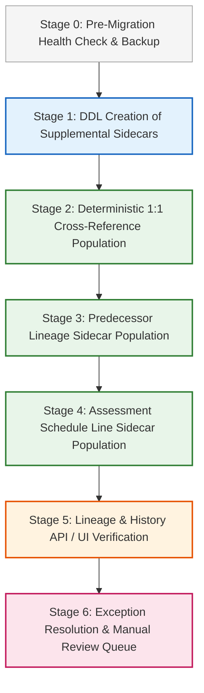

# ETRACS → Assessor Repo: Non-Destructive Migration Implementation Plan

**Document Date:** October 21, 2026  
**Phase:** Phase 5A & 5A.1 Implementation Planning  
**Strategy:** Zero Mutation of Native Properties via Sidecar / Supplemental Architecture  
**Core Objective:** Safely bridge ETRACS historical lineage, predecessor snapshots, and granular assessment lines into the Assessor Repo without touching `wp_assessor_properties`.

---

## 1. Non-Destructive Migration Principles

1. **Native Immutability:** `wp_assessor_properties` contains 12,256 verified records managed by the municipality. A future migration must **never** execute an `UPDATE`, `DELETE`, or `REPLACE` directly on native property rows.
2. **Supplemental Sidecar Approach:** All imported ETRACS data (cross-reference mapping, structured predecessors, assessment line schedules) must reside in separate supplemental tables linked via native property UUIDs.
3. **No ID Conflation:** Native UUIDv7 identifiers are never overwritten by ETRACS `objid` strings. ETRACS identifiers are stored strictly as foreign reference attributes.
4. **Deterministic Rollback:** Because native tables are never modified in-place, the entire migration can be rolled back at any moment by dropping or clearing the supplemental tables.
5. **No Automatic Merge on TD Alone:** A matching TD number establishes candidate association, but field differences (such as PIN formatting discrepancies) must be explicitly classified and auditable.
6. **Preserve Legacy Identifiers and NULLs:** Populated ETRACS IDs (`prevfaasid`) that cannot be resolved electronically (28 rows) must be preserved as distinct unresolved references, strictly segregated from NULL IDs (9,586 rows). Missing IDs must be classified as: “Recorded historical TD reference; source provenance unknown unless supported by separate documentary evidence.”

---

## 2. Phased Migration Workflow



---

### Stage 1: DDL Creation of Supplemental Sidecar Tables
Create three dedicated supplemental tables without altering existing tables:
1. `wp_assessor_etracs_crossref`: Maps native `property_id` to shadow `faas_objid` with mutually exclusive match classifications:
   - `EXACT_1TO1_PIN_MATCH` (Category A1: 7,543 rows)
   - `EXACT_1TO1_PIN_DIFF` (Category A2: 3,218 rows)
   - `EXACT_1TO1_PIN_MISSING` (Category A3: 11 rows)
   - `PIN_MATCH_TD_DIFF` (Category B1/B2: 253 rows)
   - `UNMATCHED_NATIVE` (Category C: 1,231 rows)
2. `wp_assessor_property_predecessors`: Stores structured multi-predecessors, electronic parent pointers, legacy ETRACS pointers, and locked historical snapshots.
3. `wp_assessor_property_assessments`: Stores granular assessment lines per actual use classification.

---

### Stage 2: Cross-Reference Population Rules
- **Tier 1 (Highest Confidence - 7,543 properties):**
  - Both TD number and PIN match identically (`Category A1`). Record `match_type = 'EXACT_1TO1_PIN_MATCH'` and `confidence = 1.00`.
- **Tier 2 (Exact TD with PIN Discrepancy - 3,218 properties):**
  - TD matches identically, but PIN strings differ (`Category A2`).
  - 1,332 records match under alphanumeric normalization, while 1,886 reflect substantive parcel revision differences.
  - Record original values without modification: `match_type = 'EXACT_1TO1_PIN_DIFF'` and `confidence = 0.90`.
- **Tier 3 (Exact TD with Missing PIN - 11 properties):**
  - Record `match_type = 'EXACT_1TO1_PIN_MISSING'` and `confidence = 0.80`.
- **Tier 4 (Exception Review Queue - 253 properties):**
  - The 253 properties with No TD match but matching PIN (`Category B1/B2`) are flagged for review and not automatically linked.
- **Tier 5 (Pure Native - 1,231 properties):**
  - Retained with `match_type = 'UNMATCHED_NATIVE'` (no shadow ETRACS link).

---

### Stage 3: Predecessor Lineage Migration
- For every mapped native property, extract associated predecessor links from `wp_assessor_faas_previous`.
- **Case 1 (Electronic Resolves - 9,239 rows):** If `prevfaasid` maps to an existing native property via the crossref table, populate `predecessor_property_id = [Native Parent UUID]` and `resolution_status = 'ELECTRONIC'`.
- **Case 2 (Recorded Reference, NULL ID - 9,586 rows):** If `prevfaasid` is NULL, populate `predecessor_property_id = NULL`, `recorded_tdno = [prevtdno]`, and `resolution_status = 'RECORDED_ONLY'`. Document provenance as: “Recorded historical TD reference; source provenance unknown unless supported by separate documentary evidence.”
- **Case 3 (Legacy Dangling Pointer - 28 rows):** If `prevfaasid` is populated but does not resolve, populate `predecessor_property_id = NULL`, `etracs_prevfaasid = [prevfaasid]`, `recorded_tdno = [prevtdno]`, and `resolution_status = 'LEGACY_UNRESOLVED'`.
- **Snapshot Transfer:** Populate `prev_owner`, `prev_pin`, `prev_av`, `prev_mv`, `prev_area_sqm`, and `prev_effectivity` directly from the locked historical fields in `wp_assessor_faas_previous` (17,992 rows possess all 6 snapshot fields simultaneously).

---

### Stage 4: Granular Assessment Line Migration
- For the **10,771** matched properties with shadow assessments, transfer lines from `wp_assessor_rpu_assessment` into `wp_assessor_property_assessments`.
- Validate that the sum of child assessed values equals the native property's stored `assessed_value`.
- If a discrepancy exists (e.g. minor historical rounding difference), flag the row as `has_discrepancy = 1` while preserving the native `assessed_value` as authoritative.

---

### Stage 5: Verification and Rollback Testing
- **Read-Only Verification:**
  - Verify that `wp_assessor_properties` row count remains exactly **12,256**.
  - Verify that zero timestamps, UUIDs, or existing values in `wp_assessor_properties` have changed.
  - Query lineage visualizers in the UI to confirm that historical tax declaration chains render seamlessly.
- **Rollback Procedure:**
  - If any unexpected behavior occurs, execute:
    ```sql
    DROP TABLE IF EXISTS wp_assessor_property_assessments;
    DROP TABLE IF EXISTS wp_assessor_property_predecessors;
    DROP TABLE IF EXISTS wp_assessor_etracs_crossref;
    ```
  - The native application returns instantly to 100% pre-migration baseline functionality.

---

## 3. Unresolved Decisions Requiring Municipal Assessor Approval

1. **PIN Format Standardization:** Normalization analysis in Phase 5A.1 revealed 46 native collision groups and 6 shadow collision groups. Should PIN formatting be left permanently as recorded, or standardized through an explicit parcel survey review?
2. **Handling Unmatched Historical ETRACS Declarations (7,871 records):** Should superseded ETRACS declarations that were never part of the native active table be migrated into native properties with `status = 'cancelled'`, or kept strictly in the read-only shadow replica for historical archive queries?
3. **Source vs. Shadow Cutoff Timing:** The 2 missing records in shadow (`22-010-0001-09733` and `09734`) confirm that the shadow replica represents an immutable historical snapshot. Should any future refresh occur before or after sidecar population?

---

## 4. Phase 5A.1 Correction Log

- **Reconciled Matching Categories:** Replaced overlapping candidate counts with strict, mutually exclusive categories at both native-property grain (Denominator: 12,256) and shadow-FAAS grain (Denominator: 18,839).
- **Barangay Matching Audit:** Clarified that the 10,772 match is based on exact TD number alone; joining `location = barangay` fails on 1,868 records due to spelling and format differences.
- **Source vs. Replica Delta Resolved:** Reconciled the 2-row delta between `etracs254_kitaotao` and `assessor_local` across FAAS, `faas_previous`, and RPU tables. Identified specific `objid`s and verified zero impact on native properties.
- **Snapshot and Cancellation Completeness Calculated:** Verified simultaneous 6-field snapshot completeness (17,992 rows, 95.43%) and simultaneous 3-field cancellation completeness (8,890 rows, 99.91%).
- **Predecessor Terminology Standardized:** Replaced unsupported "physical book" assertions with explicit evidential classification.
