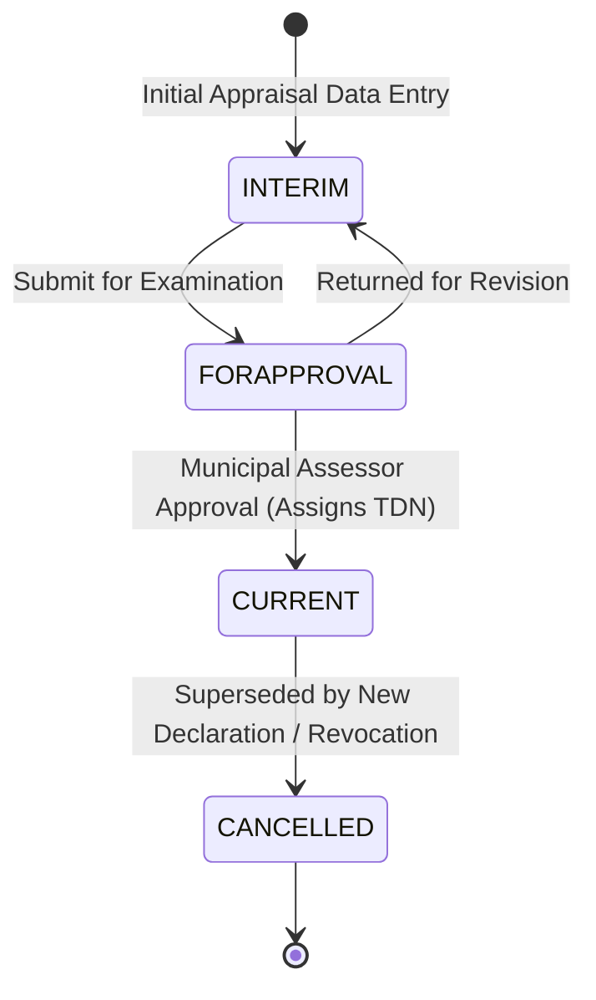

# ETRACS 2.54 → Assessor Repo: Shadow ETRACS Implementation Blueprint

**Document Date:** October 21, 2026  
**Phase:** Phase 6 — Shadow ETRACS Redesign & Implementation Blueprint  
**Primary Evidence Base:** `etracs254_kitaotao` Legacy Investigation (Phases 2–4), Phase 5 Requirements Matrix, Phase 5A Feasibility, Phase 5B Sync Safety Analysis  
**Target System:** Dedicated Shadow ETRACS Subsystem inside Assessor Repo (`assessor-backend` & `assessor-frontend`)  

---

## 1. Absolute Architecture Boundary

### A. Native Assessor Subsystem — Strictly Off-Limits
The native Assessor subsystem is the active operational core of the municipality's primary application. The following components are **strictly off-limits**:
- `wp_assessor_properties` (12,256 verified records).
- Native property states (`wp_assessor_property_states`), versions (`wp_assessor_property_versions`), documents (`wp_assessor_documents`), audit logs (`wp_assessor_audit_trail`), and requests (`wp_assessor_requests`).
- Native database schemas, primary/foreign keys, timestamps, and UUID identifiers.
- Native CRUD workflows, public search APIs, document issuance, and bidirectional cloud synchronization (`class-assessor-sync.php`, `class-assessor-sync-receiver.php`).
- Any native-to-shadow linking, cross-reference mapping, data merging, or relinking.
- **Zero native-linked sidecar tables** (proposals like `wp_assessor_etracs_crossref` remain permanently eliminated).

### B. Shadow ETRACS Subsystem — The Implementation Target
This blueprint redesigns and enhances the **existing Shadow ETRACS module itself**:
- `wp_assessor_faas` (18,839 records)
- `wp_assessor_faas_previous` (18,853 records)
- `wp_assessor_rpu` (18,841 records)
- `wp_assessor_real_property` (14,892 records)
- `wp_assessor_rpumaster` (27,659 records)
- `wp_assessor_rpu_assessment` (22,430 records)
- Related tables: `land*`, `bldg*`, `mach*`, `planttree*`, `entity*`, `barangay`, `propertyclassification`.
- ETRACS-specific backend services (`class-assessor-etracs.php`), REST controllers (`class-assessor-api.php`), synchronization (`class-assessor-etracs-sync.php`), and React components (`EtracsPropertyTable.js`, `EtracsPropertyFormModal.js`, `TaxDeclarationPreviewModal.js`, `BuildingFaasEditor.js`, `EtracsEntityTable.js`).

---

## 2. Executive Summary of Audit Findings on Existing Shadow Module

Code inspection of the active local repository reveals that the existing Shadow ETRACS subsystem has substantial existing capabilities alongside 10 critical verified gaps:

### A. Existing Functionality That Is Correct & Preserved:
1. **Rich Normalized Schema:** `class-assessor-database.php` creates 35+ ETRACS-compatible tables mirroring legacy ETRACS 2.54.
2. **FAAS and Entity Query Services:** `get_faas_list()`, `get_faas()`, `get_entities()`, and `get_barangays()` provide high-performance paginated queries.
3. **Official Preview Document:** `TaxDeclarationPreviewModal.js` accurately renders the statutory appraisal sheet, assessment schedule, and signatories.
4. **Specialized Building Editor:** `BuildingFaasEditor.js` interfaces with unit construction cost schedules (`bldgkindbucc`) and structural types.
5. **Backend Cancellation Mechanics:** `cancel_faas()` correctly enforces that only `CURRENT` records can be cancelled and populates `canceldate`, `cancelreason`, `cancelnote`, and `cancelledtimestamp`.

### B. The 10 Verified Implementation Gaps:
1. **No Insertion into `wp_assessor_faas_previous` on Create/Update:**  
   `class-assessor-etracs.php::create_faas()` (lines 489–495) writes scalar predecessor strings (`prevtdno`, `prevowner`) to `wp_assessor_faas` but **never inserts child rows into `wp_assessor_faas_previous`**. Newly created declarations have zero relational predecessor rows.
2. **Missing Assessment Line Persistence:**  
   `class-assessor-etracs.php::create_faas()` (lines 463–465) creates `wp_assessor_rpu` with scalar totals but **never inserts child rows into `wp_assessor_rpu_assessment`**.
3. **Hardcoded Initial Lifecycle State:**  
   `create_faas()` hardcodes `state = 'CURRENT'` (line 470). There is no mechanism to save an `INTERIM` draft or submit a `FORAPPROVAL` appraisal before formal issuance.
4. **Redundant Duplicate Parcel Roots on Subsequent Revisions:**  
   `create_faas()` always calls `create_real_property()` (line 461), creating a new parcel row even when issuing a revision or adding an improvement to an existing parcel.
5. **`rpumaster` Continuity Disconnected on Writes:**  
   `wp_assessor_rpumaster` is populated during read-only sync, but is never updated or referenced when creating new transactions.
6. **Destructive `$wpdb->replace()` Sync Overwrite Hazard:**  
   `Assessor_Etracs_Sync::trigger_sync()` pulls remote records using `$wpdb->replace()`, which will overwrite any local edits made to matching primary keys or delete rows on unique key conflicts (`ux_faas_utdno`).
7. **Lack of Provenance Column in Shadow Tables:**  
   Shadow tables have no `origin_type` column; replicated rows and locally authored rows coexist without schema-level distinction.
8. **Frontend Cancel Dialog Missing Successor TD Input:**  
   `EtracsPropertyTable.js` cancel modal prompts for cancel reason and note, but omits `cancelledbytdnos`.
9. **Zero Audit Trail Logging for Shadow Mutations:**  
   `class-assessor-etracs.php` executes direct SQL updates without logging to `wp_assessor_audit_trail`.
10. **Predecessor Snapshot Value Loss on Manual Authoring:**  
    Locked snapshot values (`prevav`, `prevmv`, `prevareasqm`) are lost because they are not stored into `wp_assessor_faas_previous`.

---

## 3. Resolving the Shadow Sync Ownership Problem

### Evaluation of Ownership Strategies
- **Option 1: Treat Shadow Subsystem as Strict Read-Only Mirror:**  
  *Pros:* Zero sync collision risk.  
  *Cons:* Fails the core user requirement to redesign Shadow ETRACS to support property declaration management.
- **Option 2: Physical Separate Authoring Tables (`wp_assessor_etracs_authored_*`):**  
  *Pros:* Complete isolation from sync.  
  *Cons:* Fragmented schema; duplicate tables; complex queries; deviates from changing the shadow subsystem itself.
- **Option 3 (RECOMMENDED): In-Place Enhanced Shadow Subsystem with Explicit Provenance & Protected Upsert:**  
  *Implementation:* Enhance the existing shadow tables by adding an `origin_type enum('REPLICA', 'LOCAL') DEFAULT 'REPLICA'` column, and redesign `trigger_sync()` to use **Protected Upsert (`INSERT ... ON DUPLICATE KEY UPDATE`)** that explicitly refuses to overwrite records where `origin_type = 'LOCAL'`.

### Detailed Sync Protection Rules:
1. **Schema Column Addition:**
   Add `origin_type enum('REPLICA', 'LOCAL') NOT NULL DEFAULT 'REPLICA'` to `wp_assessor_faas`, `wp_assessor_rpu`, `wp_assessor_real_property`, `wp_assessor_faas_previous`, and `wp_assessor_rpu_assessment`.
2. **Refactored Ingestion Logic (`trigger_sync`):**
   Replace raw `$wpdb->replace()` with:
   ```sql
   INSERT INTO wp_assessor_faas (...) VALUES (...)
   ON DUPLICATE KEY UPDATE
       state = IF(origin_type = 'LOCAL', state, VALUES(state)),
       owner_name = IF(origin_type = 'LOCAL', owner_name, VALUES(owner_name)),
       ... -- all columns protected if origin_type == 'LOCAL'
   ```
3. **Preflight TD Collision Check:**
   Before pulling remote records, check if any incoming `utdno` matches a record with `origin_type = 'LOCAL'`. If a collision is detected, flag a sync conflict exception in `wp_options` without overwriting the local record.
4. **Authoring Write Attribution:**
   All records created or modified via `class-assessor-etracs.php` are explicitly tagged with `origin_type = 'LOCAL'`.

---

## 4. Target ETRACS Data Model & Workflow Design



### A. Declaration Lifecycle & State Machine
1. **`INTERIM` (Draft):** Initial field appraisal data capture. Editable by appraiser/editor. No legal TD assigned.
2. **`FORAPPROVAL` (Submitted):** Appraisal finalized and submitted to Municipal Assessor. Locked against general edits.
3. **`CURRENT` (Approved & Active):** Approved by Municipal Assessor. Official TD number assigned. `dtapproved` and `approved_by` populated. Automatically transitions referenced predecessor declarations to `CANCELLED`.
4. **`CANCELLED` (Superseded):** Immutable historical declaration. Stores `cancelreason`, `canceldate`, `cancelledbytdnos`, and `cancelledtimestamp`.

### B. Predecessor Relationships (`wp_assessor_faas_previous`)
Support the 3 validated ETRACS predecessor typologies:
- **Case 1 (Electronic Resolving):** `prevfaasid` resolves to existing FAAS in `wp_assessor_faas`. Populates locked snapshot values from the predecessor record.
- **Case 2 (Recorded Historical Reference):** `prevfaasid IS NULL`, but `prevtdno` is recorded. Provenance documented as: *“Recorded historical TD reference; source provenance unknown unless supported by separate documentary evidence.”*
- **Case 3 (Legacy Dangling Pointer):** `prevfaasid` is populated with an unresolved legacy ID. Preserved as recorded without throwing errors.
- **Multi-Predecessor Support:** `wp_assessor_faas_previous` stores multiple rows per child `faasid` for consolidation (`CS`) or combined transactions.

### C. RPU and Real-Property Hierarchy
- **Parcel Re-Use Rule:** `create_faas()` accepts an optional `realpropertyid`. If provided, the new RPU links to the existing parcel geometry, preventing duplicate land records.
- **RPUMaster Tracking:** When a transaction becomes `CURRENT`, `wp_assessor_rpumaster` is updated so `currentfaasid` and `currentrpuid` point to the newly approved declaration instance.

### D. Assessment Schedules (`wp_assessor_rpu_assessment`)
- When authoring a declaration, the user inputs assessment lines (Classification, Actual Use, Market Value, Assessment Level %).
- `assessedvalue` is calculated deterministically: $\text{Market Value} \times (\text{Assessment Level} / 100)$.
- `total_market_value` and `total_assessed_value` on `wp_assessor_rpu` are computed as the exact sum of child lines.

---

## 5. Target API and Frontend Workflow Specification

### A. Backend Endpoints (`class-assessor-api.php` & `class-assessor-etracs.php`)
- `GET /assessor/v1/etracs/faas`: Enhanced with `origin` filter (`ALL`, `REPLICA`, `LOCAL`) and state filters.
- `POST /assessor/v1/etracs/faas`: Creates declaration in `INTERIM` or `CURRENT` state, saving child rows in `wp_assessor_faas_previous` and `wp_assessor_rpu_assessment`.
- `PUT /assessor/v1/etracs/faas/{id}`: Updates declaration (permitted only for `INTERIM` and `FORAPPROVAL` records, or authorized corrections).
- `POST /assessor/v1/etracs/faas/{id}/submit`: Transitions `INTERIM` $\rightarrow$ `FORAPPROVAL`.
- `POST /assessor/v1/etracs/faas/{id}/approve`: Transitions `FORAPPROVAL` $\rightarrow$ `CURRENT`, sets `dtapproved = NOW()`, `approved_by = UID`, and executes automatic predecessor cancellation.
- `POST /assessor/v1/etracs/faas/{id}/cancel`: Sets `state = 'CANCELLED'`, requiring mandatory `cancel_reason` and `cancelled_by_tdnos`.

### B. Frontend Workspace Updates (`assessor-frontend`)
- **`EtracsPropertyTable.js`:**
  - Displays lifecycle status chips: `INTERIM` (Orange), `FORAPPROVAL` (Blue), `CURRENT` (Green), `CANCELLED` (Red).
  - Displays origin badges: `[Historical ETRACS]` vs. `[Local]`.
  - Role-based action buttons: Appraisers see "Edit Draft" and "Submit"; Municipal Assessor sees "Approve" and "Cancel".
- **`EtracsPropertyFormModal.js`:**
  - Enhanced with dedicated tabs: "Appraisal Header", "Land / Building Details", "Assessment Schedule" (line items grid), "Predecessors" (multi-predecessor table with snapshot capture).
- **`TaxDeclarationPreviewModal.js`:**
  - Enhanced to render multi-predecessors and structured assessment line items.

---

## 6. Implementation Work Packages & Roadmap Summary

Detailed in [`etracs_shadow_implementation_work_packages.csv`](file:///D:/CODE/assessor/etracs-scripts/etracs_shadow_implementation_work_packages.csv) and [`etracs_shadow_implementation_roadmap.md`](file:///D:/CODE/assessor/etracs-scripts/etracs_shadow_implementation_roadmap.md):

- **Stage 1 (WP-01): Data Ownership & Sync Overwrite Protection** (Critical Prerequisite)
- **Stage 2 (WP-02, WP-03, WP-04): Core FAAS, Predecessors & Assessment Line Persistence**
- **Stage 3 (WP-05, WP-06, WP-07): Lineage Continuity, Cancellation & Audit Trails**
- **Stage 4 (WP-08): Frontend Workspace & Form Integration**
- **Stage 5 (WP-09): Regression Testing & Safety Rollout**

---

*Blueprint compiled for Phase 6 review. No application code, schemas, or database records were modified.*
