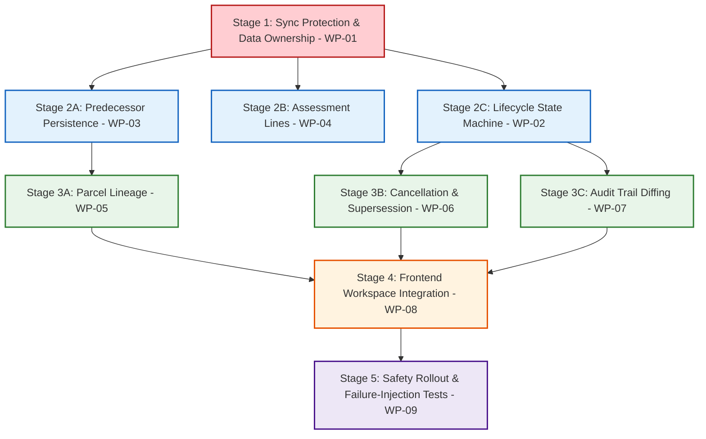

# ETRACS 2.54 → Assessor Repo: Shadow ETRACS Implementation Roadmap

**Document Date:** October 21, 2026  
**Phase:** Phase 6 — Shadow ETRACS Implementation Roadmap  
**Target System:** Dedicated Shadow ETRACS Subsystem (`assessor-backend` & `assessor-frontend`)  
**Core Boundary Rule:** **ALL NATIVE ASSESSOR TABLES ARE OUT OF SCOPE.** Native tables (`wp_assessor_properties`, property states, versions, documents, audit logs, requests, cloud sync) and their existing relationships remain 100% untouched.

---

## 1. Roadmap Phasing & Dependency Graph

---

## 2. Detailed Implementation Stages

### Stage 1: Data Ownership & Sync Protection (Prerequisite)
- **Work Package:** `WP-01`
- **Objective:** Establish schema-level provenance (`origin_type`) and refactor `Assessor_Etracs_Sync::trigger_sync()` to prevent destructive overwrite of locally created/edited records during upstream sync pulls.
- **Affected Files:**
  - `class-assessor-database.php`: Add `origin_type enum('REPLICA', 'LOCAL') NOT NULL DEFAULT 'REPLICA'` to `wp_assessor_faas`, `wp_assessor_rpu`, `wp_assessor_real_property`, `wp_assessor_faas_previous`, and `wp_assessor_rpu_assessment`.
  - `class-assessor-etracs-sync.php`: Refactor `$wpdb->replace()` to `INSERT ... ON DUPLICATE KEY UPDATE` protecting `origin_type = 'LOCAL'`. Add preflight check aborting sync on unique key collisions (`ux_faas_utdno`).
- **Data Preservation:** 18,839 existing historical FAAS records default to `origin_type = 'REPLICA'`.
- **Exit Gate:** Automated test verifying that executing `trigger_sync()` does not overwrite, delete, or alter any row marked as `LOCAL`.

---

### Stage 2: Core Transaction Data Layer
- **Work Packages:** `WP-02` (Lifecycle), `WP-03` (Predecessors), `WP-04` (Assessments)
- **Objective:** Fix the critical CRUD gaps in `class-assessor-etracs.php` so newly created declarations persist child predecessor links and assessment lines.
- **Affected Files:**
  - `class-assessor-etracs.php`:
    - `create_faas()` & `update_faas()`: Insert child rows into `wp_assessor_faas_previous` and `wp_assessor_rpu_assessment`.
    - Auto-compute total assessed value and market value from child assessment lines.
    - Support initial states: `INTERIM`, `FORAPPROVAL`, `CURRENT`.
    - Add `approve_faas()` setting `dtapproved = NOW()` and `approved_by = current_user_id`.
- **Exit Gate:** Creating a FAAS with 2 predecessors and 2 assessment lines correctly populates child tables and locks snapshot values.

---

### Stage 3: Lineage Continuity, Cancellation & Auditing
- **Work Packages:** `WP-05` (Parcel Lineage), `WP-06` (Cancellation), `WP-07` (Audit Trail)
- **Objective:** Support shared parcel geometry across improvements, robust predecessor cancellation, and complete change tracking.
- **Affected Files:**
  - `class-assessor-etracs.php`:
    - Allow `create_faas()` to link to existing `realpropertyid`.
    - Update `wp_assessor_rpumaster` pointers upon declaration approval.
    - Enforce mandatory `cancelreason` and `cancelledbytdnos` in `cancel_faas()`.
  - `class-assessor-audit.php`: Log composite JSON diffs to `wp_assessor_audit_trail` for all shadow FAAS actions.
- **Exit Gate:** Creating an improvement attaches to existing parcel root without duplicate real_property rows; cancellation verifies successor TD link.

---

### Stage 4: Frontend Workspace Integration
- **Work Package:** `WP-08`
- **Objective:** Enhance the user interface in `assessor-frontend` to provide complete declaration management, statutory preview, and lineage visualization.
- **Affected Files:**
  - `EtracsPropertyTable.js`: Status chips (`INTERIM`, `FORAPPROVAL`, `CURRENT`, `CANCELLED`), origin badges (`[Historical ETRACS]` vs `[Local]`), and role-based action buttons.
  - `EtracsPropertyFormModal.js`: Multi-predecessor table, statutory assessment schedule grid with automatic `MV * AL% = AV` calculation.
  - `TaxDeclarationPreviewModal.js`: Predecessor history and detailed assessment schedule rendering.
- **Exit Gate:** Appraiser can author, edit, submit, and preview a declaration seamlessly in the web browser.

---

### Stage 5: Rollout, Regression & Safety Testing
- **Work Package:** `WP-09`
- **Objective:** Validate end-to-end system stability, disaster recovery, and isolation assertions.
- **Safety Assertions:**
  1. **Native Immutability:** `SELECT COUNT(*) FROM wp_assessor_properties` equals 12,256; zero native records or schemas touched.
  2. **Sync Overwrite Immunity:** Upstream sync pull execution causes zero data loss for local records.
  3. **Unique Collision Rejection:** TD collision halts with clear error rather than silent overwrite.
  4. **Replica Integrity:** Historical 18,839 declarations remain 100% consistent with baseline audits.

---

*Roadmap finalized for Phase 6 review. No code or database changes were implemented.*
